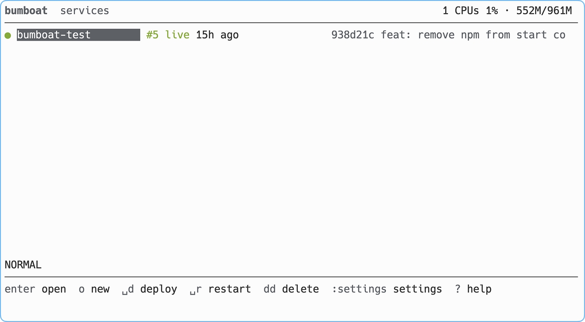
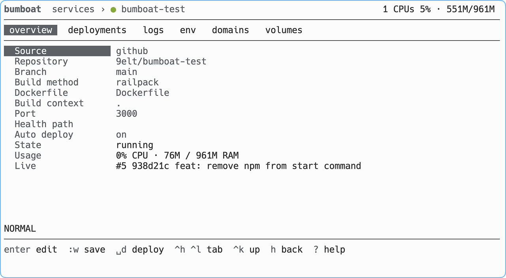

# Bumboat

Push-to-deploy for one Linux server, managed from a vim-style TUI over SSH.
Deploy GitHub repos or Docker images to their own domains, over HTTPS and with no downtime.

One Go binary, no web UI. The daemon is the reverse proxy, the webhook receiver and the build queue.

<p>
  
  
</p>

## Install

Needs Docker with buildx, git, and free 80 and 443 ports.

```shell
curl -fsSL https://raw.githubusercontent.com/9elt/bumboat/main/install.sh | sudo sh
```

Then run `bumboat`.

> [!NOTE]
> For a bare Ubuntu 24.04 server you can run this. It creates an ssh key, sets up the firewall, Docker and a `bumboat` user, installs bumboat and opens it.
>
> ```shell
> curl -fsSL https://raw.githubusercontent.com/9elt/bumboat/main/ubuntu-setup.sh | sh
> ```
>
> Works on Linux and macOS, on Windows it requires WSL or Git Bash.

## Use

- Connect GitHub once with `:settings` and `<space>g` to install the app on the repos you want.
- Add a service with `o`.
- Use `:sh` to open a shell in a service's container.
- Use `?` to show other shortcuts.

```
bumboat ls | deploy <svc> | logs <svc> [-f] [--build] | backup | restore | upgrade
```

State lives in `/var/lib/bumboat` and `/etc/bumboat/master.key`.

## Backup

A backup holds the database, master key, certificates and every volume.
Each service with volumes is paused while they are copied.

On the server

```shell
bumboat backup
bumboat restore bumboat-backup-<date>.tar.gz
```

From your machine (restore requires `root`)

```shell
ssh <user>@<server> bumboat backup - > bumboat-backup.tar.gz
ssh root@<server> bumboat restore - < bumboat-backup.tar.gz
```

The master key decrypts every secret, so keep backups private.

## Develop

```shell
# regenerate the API after editing `proto/`
buf generate

# run the tests
go test ./...

# run the end-to-end test against the local Docker
scripts/e2e.sh

# open the TUI against a dev daemon in a local Docker container
scripts/dev.sh

# tag and push a release, GitHub Actions publishes it
scripts/release.sh v0.1.0
```
