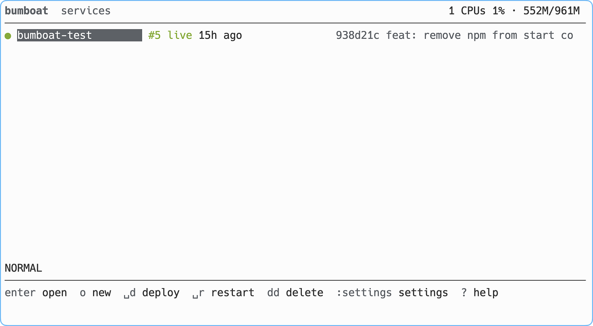
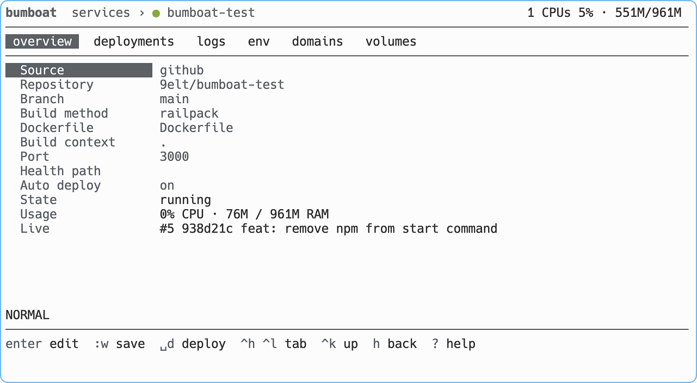

# Bumboat

Push-to-deploy for one Linux server, managed from a vim-style TUI over SSH.
Deploy GitHub repos or Docker images to their own domains, over HTTPS and with no downtime.

One Go binary, no web UI. The daemon is the reverse proxy, the webhook receiver and the build queue.

<p>
  
  
</p>

## Install

Needs Docker with buildx, git, and free 80 and 443 ports.

```
curl -fsSL https://raw.githubusercontent.com/9elt/bumboat/main/install.sh | sudo sh
```

Then run `bumboat`.

> [!NOTE]
> For a bare Ubuntu 24.04 server you can run this. It creates an ssh key, sets up the firewall, Docker and a `bumboat` user, installs bumboat and opens it.
>
> ```
> curl -fsSL https://raw.githubusercontent.com/9elt/bumboat/main/ubuntu-setup.sh | sh
> ```
>
> Works on Linux and macOS, on Windows it requires WSL or Git Bash.

## Use

- Connect GitHub once with `:settings` and `<space>g`, open the printed link and install the app on the repos you want.
- Add a service with `o`, either a repo and branch (Dockerfile or Railpack) or an image.
- `?` shows the keys. Edits are drafts until `:w`, and `<space>d` deploys.

```
bumboat ls | deploy <svc> | logs <svc> [-f] [--build] | backup | upgrade
```

State lives in `/var/lib/bumboat` and `/etc/bumboat/master.key`.

## Develop

Regenerate the API after editing `proto/`

```
buf generate
```

Run the tests

```
go test ./...
```

Run the end-to-end test against the local Docker

```
scripts/e2e.sh
```

Open the TUI against a dev daemon in a local Docker container

```
scripts/dev.sh
```

Tag and push a release, GitHub Actions publishes it

```
scripts/release.sh v0.1.0
```
